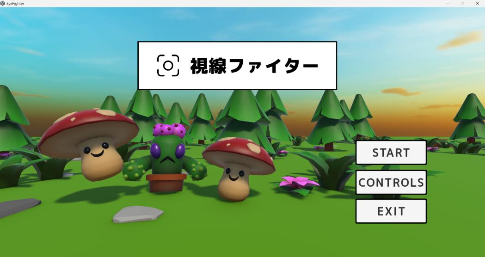
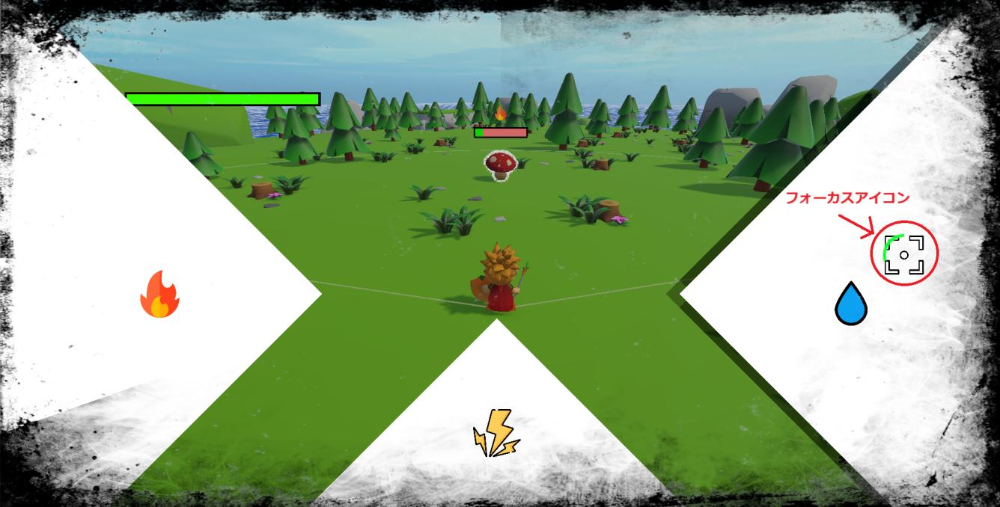
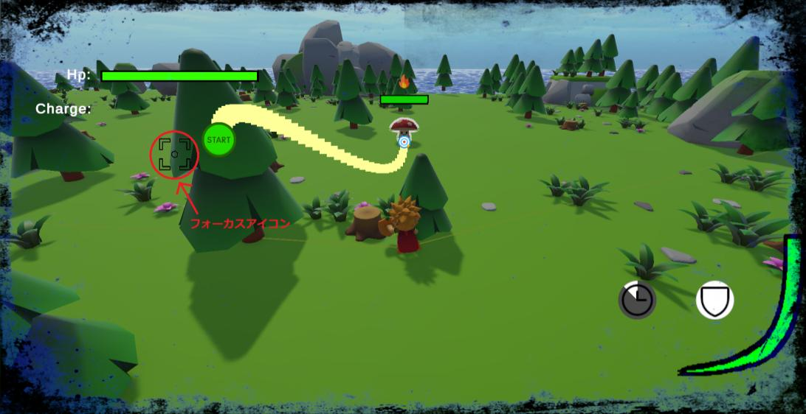
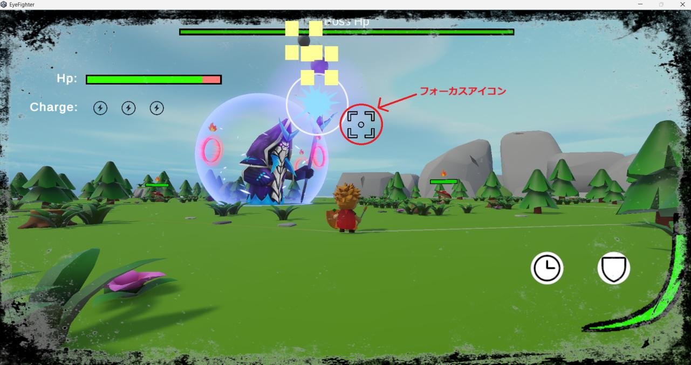
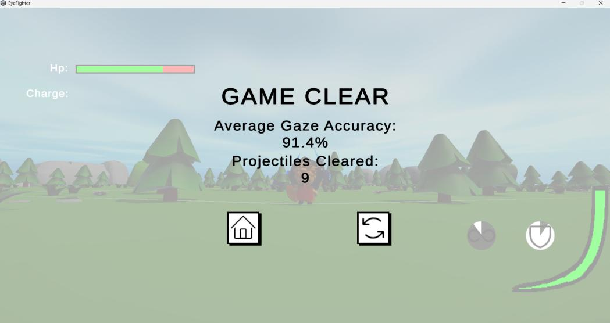

<div align="center">

# 視線ファイター（Eye Fighter）



**視線入力でQTEを行う3Dアクションゲーム**

Webカメラによるアイトラッキングを使い、「目で狙い、目でなぞり、目で防ぐ」戦闘を制作しました。


📄 **[作品説明資料（PDF）](docs/EyeFighter_slides.pdf)**

</div>

---

## 概要

| 項目 | 内容 |
|---|---|
| ジャンル | 3Dアクション |
| 制作形態 | 個人制作（大学の卒業研究） |
| 使用技術 | Unity 6 / C# / Beam Eye Tracker SDK |
| コード規模 | 自作スクリプト約77ファイル・約12,500行 |

一般的なアクションゲームの「ボタンを押せば攻撃が出る」部分を、**視線操作のQTE**に置き換えたゲームです。
戦闘中の重要な場面では時間がゆっくりになり、プレイヤーは画面上のフォーカスアイコンを目で動かして、属性の選択や攻撃、防御を行います。

アイトラッキングには、Webカメラだけで視線を推定できる [Beam Eye Tracker](https://store.steampowered.com/app/2375780/Beam_Eye_Tracker/?l=japanese) を使用しています。専用のアイトラッカー機器は不要です。

## 3つのQTEフェーズ

### ① 属性選択フェーズ


敵が範囲内にいるときに攻撃ボタンを押すと始まります。炎・水・雷のパネルのうち、敵に有利な属性をフォーカスアイコンで約1秒見つめて選びます。

### ② ラインクリアフェーズ（攻撃）


スタートアイコンから黄色い線を目でなぞり、制限時間内にゴールまで到達すると攻撃が成功します。線を正確になぞるほどダメージが上がります。

### ③ 防御フェーズ


防御ボタンを押している間、飛んでくる弾の周りに4つのマーカーが表示されます。すべてを視線で消すと、弾を弾き返せます。

### リザルト


クリア時には、**視線の平均精度**と弾き返した弾の数を表示します。

## 技術的なポイント

### 視線入力のゲームへの組み込み
- 曲線と直線の経路を生成し（`CurvedPathGenerator` / `StraightPathGenerator`）、視線がどれだけ経路をなぞれたかを精度として計算しています（`GazePathTracker`）。この精度がそのまま攻撃のダメージに反映されます。
- 操作は「一定時間見つめる」「線をなぞる」「マーカーを消す」で構成しており、一瞬で正確な一点を指す必要がないようにしています。
- QTE中は`Time.timeScale`と物理演算の更新間隔を下げてスローモーションにし、視線操作の時間を確保しています（`GameManager`）。

### 敵AI（ステートパターン）
- `IState`（Enter / Execute / Exit）を共通インターフェースとして、敵の行動を状態ごとのクラスに分けています。
- **通常の敵**：待機、接近、追跡、周回、近接攻撃、遠距離攻撃、群れへの帰還、単独徘徊
- **ボス**：歩行、突進、ミサイル、待機、気絶、バリア回復、撃破
- 敵は群れ（`EnemyGroup`）単位で管理し、群れから離れた個体が戻る動きも実装しています。

### ボス戦
- ボスはバリアを持ち、視線で線をつなぐ専用のミニゲーム（`BossMiniGame`）でバリアを破壊します。最後の線を消すとカットシーンに移行します。
- バリアは一定時間で回復するため、攻撃のタイミングを見極める必要があります。

### その他
- 弾やUIのオブジェクトプール（`ProjectilePool` / `UIPool`）
- ダメージ表示、カメラシェイク、ヒット時のエフェクト
- タイトル → ロード → ゲームのシーン遷移

## 操作方法

| 操作 | キー |
|---|---|
| 移動 | `W` `A` `S` `D` |
| 視点 | マウス |
| 攻撃（QTE開始） | `E` |
| 防御 | `Q` |
| メニュー | `Esc` |
| QTE中の操作 | 視線（フォーカスアイコン） |

## 動作環境・実行方法

- Windows
- Webカメラ
- [Beam Eye Tracker](https://store.steampowered.com/app/2375780/Beam_Eye_Tracker/?l=japanese)（Steamで配布）

### プロジェクトを開く場合
1. Unity **6000.2.6f2** をインストールします。
2. Beam Eye Tracker SDK（v2.1.0）を入手し、`Packages/manifest.json` の `tech.eyeware.beam-eye-tracker` のパスを、自分の環境のSDKの場所に書き換えます。
3. Unity Hubからこのフォルダを開き、`Assets/Scenes/MainMenu.unity` から再生します。

## フォルダ構成

```
Assets/Scripts/
├── Combat/
│   ├── MiniGame/     視線QTE（属性選択、ラインクリア、防御、ボス）
│   └── ...           ダメージ、弾、敵グループ、スポーン
├── Enemy/            敵AIのステート
│   └── BossEnemy/    ボスのステート、バリア
├── Camera/           カメラ制御、カメラシェイク
├── UI/               HP、ゲージ、視線ドット、ダメージ表示
├── Scene/            メインメニュー、ロード
└── Sound/            サウンド管理
```

## 使用アセット

- Beam Eye Tracker SDK（Eyeware）
- Cartoon FX Remaster（Jean Moreno）
- Kinematic Character Controller（Philippe St-Amand）
- Unity Default Playables（Unity Technologies）
- その他、Unity Asset Storeの3Dモデル・エフェクト素材

---

制作：Chin Qing You（陳慶祐）
